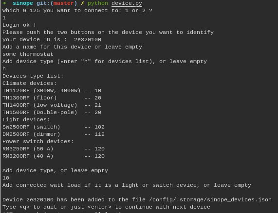

## Home Assistant Sinope-gt125 Custom Components
[🇫🇷 Version anglaise](../README.md)
> 💛 **Vous aimez cette integration?**  
> Si vous voulez supporter son développement, vous pouvez contribuer ici:
> [](https://www.paypal.me/phytoressources/)  ou
> [](Donations.md)

Ce dépôt a été scindé en deux :
- sinope-gt125, pour la gestion des appareils Miwi via une connexion directe à la passerelle Web GT125.
- sinope-1, pour la gestion des appareils Miwi via le portail [Neviweb](http://neviweb.com).

Si vous utilisez déjà ce `custom_component`, effectuez une sauvegarde de votre fichier `devices.json` avant la première mise à jour via le Marketplace. 
Le fichier `devices.json` sera supprimé. Vous devrez copier les données de vos appareils dans `config/.storage/sinope_devices.json` après la 
première exécution de `device.py` (voir ci-dessous).

Signaler un problème ou proposer une amélioration : [Créer une issue](https://github.com/claudegel/sinope-gt125/issues/new/choose)

# Home Assistant Sinope Custom Components (sinope-gt125)

Voici un composant personnalisé permettant de prendre en charge les appareils Miwi de [Sinopé Technologies](http://sinopetech.com/) dans [Home Assistant](http://www.home-assistant.io). 
Il établit une connexion directe avec la passerelle GT125 de Sinopé Technologies, permettant ainsi d'interagir avec leurs appareils intelligents Miwi, tels que les thermostats, les interrupteurs/variateurs d'éclairage 
et les contrôleurs de charge. Il prend également en charge certains appareils fabriqués par [Ouellet](http://www.ouellet.com/en-ca/products/thermostats-and-controls/neviweb%C2%AE-wireless-communication-controls.aspx).

## Appareils pris en charge
Voici la liste des appareils actuellement pris en charge. En somme, il s’agit de tout ce qui peut être ajouté dans Neviweb (appareils Miwi).
- Thermostats
  - Sinopé TH1120RF-3000 Thermostat pour tension secteur
  - Sinopé TH1120RF-4000 Thermostat pour tension secteur
  - Sinopé TH1121RF-3000 Thermostat pour les espaces publics
  - Sinopé TH1121RF-4000 Thermostat pour les espaces publics
  - Sinopé TH1300RF Thermostat pour chauffage au sol
  - Sinopé TH1400RF Thermostat basse tension
  - Sinopé TH1500RF Thermostat bipolaire
  - *Ouellet OTH2750-GT Thermostat pour tension secteur
  - *Ouellet OTH3600-GA-GT Thermostat pour chauffage au sol
- Éclairage
  - Sinopé SW2500RF Interrupteur d’éclairage
  - Sinopé DM2500RF Variateur 
- Contrôle spécialisé
  - Sinopé RM3200RF Contrôleur de charge 40 A
  - Sinopé RM3250RF Contrôleur de charge 50 A

*Non testé, mais devrait bien fonctionner. N’hésitez pas à nous faire part de vos retours si un appareil ne fonctionne pas.

## Condition préalable
Vous devez connecter vos appareils à votre passerelle Web GT125 avant de pouvoir interagir avec eux dans Home Assistant. Veuillez consulter le manuel d’utilisation 
de votre appareil ou visiter la section [Support Neviweb](https://www.sinopetech.com/blog/support-cat/plateforme-nevi-web/).

Il existe deux composants personnalisés qui vous offrent le choix de gérer vos appareils via le portail Neviweb ou directement par l’entremise de votre passerelle GT125 :
- [Neviweb](https://github.com/claudegel/sinope-1) Composant personnalisé pour gérer vos appareils Miwi via le portail Neviweb.
- [Sinope](https://github.com/claudegel/sinope-gt125) Composant personnalisé pour gérer vos appareils Miwi directement via votre passerelle GT125.

Il suffit d'en installer un seul, mais les deux peuvent être utilisés simultanément sur HA.

## Installation (voir [GT125_connect.md](custom_components/GT125_connect.md) pour des informations plus précises)
Il existe deux méthodes pour installer ce composant personnalisé :
- via le Home Assistant Marketplace (méthode privilégiée) :
  - Installez « Sinope GT125 » depuis la boutique et utilisez l'exemple de configuration.yaml ci-dessous.
- Manuellement via un téléchargement direct :
  - Téléchargez le fichier zip de ce dépôt en utilisant le bouton de téléchargement vert situé en haut à droite.
  - Extrayez le fichier zip sur votre ordinateur, puis copiez le dossier `custom_components` dans son intégralité dans le répertoire « config » de Home Assistant
    (là où se trouve votre fichier `configuration.yaml`).
    - homeassistant-supervisé (Hass.io) : /config/
  - Votre répertoire «config» devrait se présenter comme suit :

    ```
    «config»/
      configuration.yaml
      .storage/
        sinope_devices.json
        sinope_devices_2.json  (si vous avez deux GT125)
      custom_components/
        sinope/
          __init__.py
          light.py
          switch.py
          climate.py
          helpers.py
          device.py
          const.py
          services.yaml
          crc8.py
      ...
    ```
    Sur Hass.io, il semble très difficile d'ajouter des bibliothèques Python ; nous avons donc ajouté `crc8.py` dans le dossier `sinope`.
    
## Configuration

Pour activer la gestion Sinope dans votre installation, ajoutez ce qui suit à votre fichier `configuration.yaml`, puis redémarrez Home Assistant.

```yaml
# Exemple d’entrée dans configuration.yaml
sinope:
  server: "<Adresse IP de votre GT125>"
  id: "<Identifiant inscrit au dos de votre GT125>" aucun espace
  api_key: "<Clé API reçue lors de la première connexion manuelle avec le GT125>" #Exécutez device.py pour cela
  server_2: "<Adresse IP de votre second GT125>" <Optionnel>
  id_2: "<Identifiant inscrit au dos de votre deuxième GT125>" <Optionnel> aucun espace
  api_key_2: "<Clé API reçue lors de la première connexion manuelle avec le second GT125>" <Optionnel> #Exécutez device.py pour cela
  my_city: "<la ville la plus proche>" # Ex. : « Montréal ». Cette information est nécessaire pour obtenir les heures de lever et de coucher du soleil à votre emplacement. <Facultatif>
  scan_interval: 120 #Vous pouvez descendre jusqu’à 60 si vous le souhaitez, en fonction du nombre d’appareils à mettre à jour. La valeur par défaut est fixée à 180. <Optionnel>
  ```
Assurez-vous que les paramètres sont placés entre guillemets « "" », à l'exception de `scan_interval`, qui est un nombre.

Les paramètres DK_KEY et MY_WEATHER ont été supprimés.

## Première exécution

Pour configurer ce `custom_component`, connectez-vous via SSH à votre Raspberry Pi et accédez au répertoire `config/custom_components/sinope` où vous avez copié les fichiers. 
Vous pouvez également utiliser le module complémentaire « Advanced SSH & Web Terminal » pour accéder à un terminal directement depuis Home Assistant (méthode recommandée). 
Préparez les informations suivantes :
Au démarrage, le script `device.py` vous demandera quel GT125 vous souhaitez configurer : le serveur n° 1 ou le serveur n° 2.
- Adresse IP du GT125,
- Identifiant du périphérique GT125, inscrit au dos du périphérique,
- Le numéro de port pour se connecter au GT125 doit être 4550 (par défaut).
Si vous devez configurer deux GT125, veillez à disposer des informations nécessaires pour chacun d'eux. Vous pouvez utiliser `device.py` à plusieurs reprises pour ajouter
des appareils à l'un ou l'autre de vos deux GT125. Si vous ne possédez qu'un seul GT125, omettez simplement le paramètre correspondant au second appareil.
- Dans le cas de homeassistant-supervised (Hass.io), vous travaillez déjà en tant qu'utilisateur root ; vous n'avez donc pas besoin de la commande sudo.
- Pour savoir si Python est installé, exécutez `python --version` dans le terminal, ou bien tapez `python` et appuyez sur la touche TAB. Cela devrait afficher `python`, `python3` et
  `python3-xx`, où « xx » correspond à la version de Python installée dans HA.
- For easyer install on homeassistant-supervised (Hass.io) add the package «advanced ssh & Web Terminal». With this you don't need to install SSH and you'll be able to edit your config and run device.py directly in a web console inside of HA.

Exécutez la commande « python3 device.py » dans la console (pour Python 3.10 : « python3.10 device.py »). L'utilisation de « sudo » est nécessaire pour corriger 
les permissions des fichiers. Dans le cas de Home Assistant Supervised (Hass.io), « sudo » n'est pas requis. Assurez-vous de vous trouver dans le répertoire 
« config/custom_components/sinope » au moment de l'exécution de « device.py », faute de quoi le script ne pourra pas s'exécuter. L'exécution de « device.py » 
est indispensable pour installer les données mentionnées ci-dessus, obtenir la clé API (« Api_Key ») et, par la suite, l'identifiant (« deviceID ») de chaque 
appareil Sinopé connecté à votre passerelle GT125. Lors de la première exécution, « device.py » vous demandera l'adresse IP, l'identifiant API (« Api ID ») et 
le numéro de port, puis enverra une requête « ping » à la GT125. Le script vous invitera ensuite à appuyer sur le bouton « WEB » situé sur la GT125. 
Cette opération permettra d'obtenir la clé API.

- Une fois votre clé API (Api_Key) obtenue, toutes les données seront inscrites dans le fichier de configuration «config»/.storage/sinope_devices.json, ou dans
  «config»/.storage/sinope_devices_2.json pour le second GT125.
- Lors de la prochaine exécution de `device.py`, vous commencerez à obtenir l'identifiant (`device_id`) de tous les appareils connectés à votre GT125.
  Consultez la section « Découverte des appareils » ci-dessous. À chaque exécution de `device.py`, le programme vous demandera pour quel GT125 — le
  n° 1 ou le n° 2 — vous souhaitez ajouter des appareils.

Vous êtes prêt à configurer vos appareils Sinopé. J'ai ajouté de nombreux commentaires dans le code ; je pense donc que vous comprendrez.

La différence principale avec Neviweb est qu'avec le GT125, nous ne disposons pas de commande permettant de récupérer l'ensemble des données et informations 
d'un appareil en une seule fois. Il est nécessaire d'envoyer une requête de lecture distincte pour chaque donnée ou information souhaitée.
ex:
- ouvrir une connexion.
- Connectez-vous au GT125.
- Envoyer une demande de lecture de données concernant la température ambiante.
- Envoyer une requête de lecture de données pour la température de consigne.
- Envoyer une requête de lecture de données pour le mode (manuel, auto, arrêt, absent).
- Envoyer une requête de lecture de données pour le niveau de chauffe.
- etc
- Fermez la connexion et recommencez pour l'appareil suivant.

Il en va de même pour les requêtes d'écriture de données ; dans ce cas, nous envoyons généralement une seule donnée — comme une modification de la température ou du 
mode — à un appareil donné. Une exception concerne la requête visant à passer en mode « auto » : il est nécessaire de transmettre l'heure correcte avant d'envoyer 
la requête d'écriture pour ce mode. 

Pour la demande de rapport de données, il est possible d'envoyer des informations à tous les appareils simultanément en utilisant un identifiant spécial, `deviceID = FFFFFFFF`. 
En utilisant le service `sinope.set_outside_temperature` avec `entity_id: all`, cet identifiant spécial est automatiquement sélectionné pour transmettre la température 
extérieure à tous les thermostats. 
Pour transmettre l'heure, la date ainsi que les heures de lever et de coucher du soleil, il suffit d'utiliser le service `set_xxxx_basic_data` avec n'importe quel 
appareil ; les données seront alors diffusées vers tous les appareils simultanément.
Pour basculer tous les appareils en mode « absence » (away mode), utilisez `PRESET_AWAY` via le service `climate.set_preset_mode` ; ce mode est alors diffusé à 
l'ensemble des appareils.

## Découverte des appareils
Il semble que le GT125 utilise des identifiants d'appareil (deviceID) différents de ceux du portail Neviweb. Une fois votre clé API (`Api_key`) renseignée dans le 
fichier `sinope_devices.json`, vous devrez exécuter `device.py` pour récupérer, un par un, les identifiants de chaque appareil présent sur votre réseau. 
Le programme vous invitera à appuyer simultanément sur les deux boutons de votre appareil pour obtenir son identifiant. Ensuite, `device.py` vous demandera des 
informations sur l'appareil, telles que son nom, son type et sa charge (puissance en watts). Pour consulter la liste des types d'appareils disponibles, 
saisissez « h » lorsque le programme vous demande le type ; tous les types reconnus s'afficheront, après quoi vous pourrez indiquer celui qui correspond à votre appareil. 
Si vous ne disposez pas de toutes les informations, appuyez simplement sur « Entrée » pour laisser les champs vides ; il sera toujours possible d'ajouter les données 
manquantes ultérieurement. Tous les identifiants et les informations relatives aux appareils seront enregistrés dans le fichier `config/.storage/sinope_devices.json` 
(ou `config/.storage/sinope_devices_2.json`), garantissant ainsi qu'aucune mise à jour ultérieure ne les effacera. Une fois tous vos appareils configurés, saisissez « q » 
pour quitter le programme. Si nécessaire, modifiez le fichier `config/.storage/sinope_devices.json` pour y ajouter le nom, le type et la puissance 
(pour les dispositifs d'éclairage) de chaque appareil. La puissance des dispositifs d'éclairage n'est pas mesurée par les appareils eux-mêmes, mais est définie dans 
le portail Neviweb lors de leur configuration initiale. Il est donc nécessaire de renseigner cette valeur dans le fichier `config/.storage/sinope_devices.json` 
(qui fait office d'équivalent local au portail Neviweb) pour finaliser la configuration des appareils. Ex :

```yaml
["IP", "Api Key", "Api ID", "PORT"] <- Ne pas effacer cette ligne
["id", "name", "type", "watt"] <- Ne supprimez pas et ne modifiez pas cette ligne.
["00470100", " ", " ", " "] <- une fois détectés par device.py, ajoutez les informations des appareils entre les « " »
["2e320100", "Office heating", "10", " "] <- thermostat ex.
["5a2c0100", "Office light", "102", "60"] <- lumière ex.
["6a560100", "Outside timer", "120", " "] <- contrôle de la puissance ex.
["00470100", "Dimmer TV Room", "112", "110"] <- Variateur ex.
```
Pour les dispositifs de commutation RM3250RF et RM3200RF, vous devez appuyer sur le voyant bleu situé en haut (portant le logo Wi-Fi) afin d'obtenir l'identifiant 
du dispositif (deviceID).
Chaque fois que vous ajouterez un nouvel appareil à votre GT125, vous devrez exécuter le script `device.py` correspondant.



## Services personnalisés
Les automatisations nécessitent des services pour pouvoir envoyer des commandes (par exemple, `light.turn_on`). Pour les appareils Sinopé connectés via une 
passerelle GT125, il est possible d'utiliser des services personnalisés afin d'envoyer des informations spécifiques aux appareils ou de modifier certains 
de leurs paramètres. Ces services personnalisés sont accessibles via les outils de développement (section « Services ») ou peuvent être intégrés 
dans des automatisations :

- `sinope.set_second_display` : permet de modifier le paramètre d'affichage secondaire des thermostats, en choisissant entre la température de consigne
  et la température extérieure. Cette commande ne doit être envoyée qu'une seule fois à chaque appareil.
- `sinope.set_outside_temperature` : permet de transmettre la température extérieure à l'affichage secondaire du thermostat. Cette information doit être
  envoyée au moins une fois par heure ; dans le cas contraire, le thermostat reviendra à l'affichage de la température de consigne. Vous pouvez utiliser
  l'identifiant spécial « all » pour diffuser la donnée vers tous les appareils simultanément, ou bien envoyer la donnée à un appareil spécifique.
- `sinope.set_climate_keypad_lock` : permet de verrouiller le clavier des appareils de gestion thermique (thermostats).
- `sinope.set_light_keypad_lock` : permet de verrouiller le clavier des appareils d'éclairage.
- `sinope.set_switch_keypad_lock` : permet de verrouiller le clavier des interrupteurs.
- `sinope.set_light_event_timer` : permet de configurer une temporisation pour les événements liés aux appareils d'éclairage, afin qu'ils envoient une
  notification lors de leur activation.
- `sinope.set_switch_event_timer` : permet de configurer une temporisation pour les événements liés aux interrupteurs, afin qu'ils envoient une
  notification lors de leur activation.
- `sinope.set_backlight_state` : permet de définir l'état du rétroéclairage : 0 = intensité maximale, 1 = intensité variable en mode inactif, 2 = éteint
  en mode inactif, 3 = intensité toujours variable.
- `sinope.set_backlight_idle` : permet de régler l'intensité du rétroéclairage lorsque l'appareil est inactif (0 = éteint, 1 à 100 = niveau d'intensité).
- `sinope.set_led_indicator` : permet de modifier la couleur et l'intensité de l'indicateur LED sur les appareils d'éclairage, pour les états « allumé »
  (on) et « éteint » (off). Vous pouvez spécifier n'importe quelle couleur via les paramètres RVB (rouge, vert, bleu) et ajuster l'intensité de la LED.
- `sinope.set_climate_basic_data` : ce service transmet la date, l'heure, ainsi que les heures de lever et de coucher du soleil à chaque appareil
  pour assurer un fonctionnement précis. Il doit être envoyé une fois par jour, via une automatisation, pour garantir un bon fonctionnement. Il suffit
  de spécifier un seul appareil ; tous les autres seront alors mis à jour. Cette opération ne doit être effectuée que sur un seul appareil, qu'il
  s'agisse d'un thermostat, d'un éclairage ou d'un interrupteur.
- `sinope.set_light_basic_data` : ce service transmet la date, l'heure, ainsi que les heures de lever et de coucher du soleil à chaque appareil afin
  d'assurer un fonctionnement précis. Pour garantir un bon fonctionnement, ce service doit être appelé une fois par jour via une automatisation.
  Il suffit de spécifier un seul appareil ; tous les autres seront alors mis à jour. Cette opération ne doit être effectuée que sur un seul appareil,
  qu'il s'agisse d'un thermostat, d'un éclairage ou d'un interrupteur.
- `sinope.set_switch_basic_data` : ce service transmet la date, l'heure, ainsi que les heures de lever et de coucher du soleil à chaque appareil
  afin d'assurer un fonctionnement précis. Pour garantir un bon fonctionnement, ce service doit être appelé une fois par jour via une automatisation.
  Il suffit de spécifier un seul appareil ; tous les autres seront alors mis à jour. Cette opération ne doit être effectuée que sur un seul appareil,
  qu'il s'agisse d'un thermostat, d'un éclairage ou d'un interrupteur.

Les trois derniers services prennent en compte le fuseau horaire défini dans HA ou utilisent le fuseau horaire par défaut, America/Toronto. Ils gèrent
également les changements d'heure liés au passage à l'heure d'été.

## Dépannage

Le fichier `home-assistant.log` n'est plus utilisé ; il a été remplacé par un fichier nommé `sinope_log.txt`, situé dans votre répertoire de configuration. 
Ce fichier contient exclusivement les journaux relatifs à ce composant personnalisé (*custom component*). Le nouveau système de journalisation crée un 
fichier vide au démarrage et effectue une rotation des journaux chaque fois que le fichier atteint une taille de 2 Mo.

Afin de disposer d'un maximum d'informations pour vous aider, veuillez fournir un extrait de votre fichier `sinope_log.txt`. J'y ai ajouté des messages de 
journalisation (logs) de débogage qui pourraient aider à diagnostiquer le problème.

Vous pouvez également publier un message dans l'un de ces fils de discussion pour obtenir de l'aide :
- https://community.home-assistant.io/t/sinope-line-voltage-thermostats/17157
- https://community.home-assistant.io/t/adding-support-for-sinope-light-switch-and-dimmer/38835

### Activation des messages de débogage Sinope dans le fichier `home-assistant.log`

Ajoutez ces lignes à votre fichier `configuration.yaml`
   ```yaml
   logger:
     default: warning
     logs:
       custom_components.sinope: debug
   ```
Cela définira le niveau de journalisation par défaut sur « warning » pour l'ensemble de vos composants, à l'exception de Sinope, qui affichera des 
messages plus détaillés.

## Transmission de la température extérieure aux thermostats

Avant d'utiliser ce service, vous devez configurer le paramètre du second affichage pour chaque thermostat sur lequel vous souhaitez voir apparaître 
la température extérieure. Cette opération s'effectue une seule fois via les outils de développement (dev tools), en utilisant le service `sinope.set_second_display`.
Ensuite, il vous suffit de créer une automatisation qui transmettra cette température extérieure à vos thermostats, toutes les heures — ou plus 
fréquemment, si vous le souhaitez. La température doit être transmise au moins une fois par heure ; dans le cas contraire, le thermostat reviendra à 
l'affichage de la température de consigne.

Exemple d'automatisation :
```yaml
#################################
### Envoyer la température extérieure aux thermostats
#################################
  - id: hourly outside temp
    alias: send outside temperature
    initial_state: true
    trigger:
      platform: time_pattern
      minutes: "/59"  ## Intervalle d'envoi des données : toutes les heures (à ajuster selon les besoins)
    action:
      - service: climate.set_outside_temperature
        data_template:
          entity_id: climate.sinope_climate_office  ## Vous pouvez ajouter plusieurs appareils à mettre à jour simultanément, ou un groupe d’appareils.
          outside_temperature: "{{ state_attr('weather.openweathermap', 'temperature') }}"
   ```
   Vous pouvez utiliser n’importe quelle source de données météorologiques : OpenWeatherMap, Environnement Canada, ou même un capteur extérieur 
   qui vous indique la température locale.
   
## Customization
Installez le composant personnalisé [Custom-Ui](https://github.com/Mariusthvdb/custom-ui) via le Marketplace et ajoutez ce qui suit à votre code :

Icônes pour le niveau de chaleur : créez un dossier nommé « www » dans le répertoire racine « .homeassistant/www ».
Copiez les six icônes. Vous les trouverez dans le dossier local/www.
N’hésitez pas à améliorer mes icônes et tenez-moi au courant. (Voir icon_view2.png)

Pour chaque thermostat, ajoutez ce code dans `customize.yaml`
```yaml
climate.sinope_climate_thermostat_name:
  templates:
    entity_picture: >
      if (attributes.heat_level < 1) return '/local/heat-0.png';
      if (attributes.heat_level < 21) return '/local/heat-1.png';
      if (attributes.heat_level < 41) return '/local/heat-2.png';
      if (attributes.heat_level < 61) return '/local/heat-3.png';
      if (attributes.heat_level < 81) return '/local/heat-4.png';
      return '/local/heat-5.png';
 ```  
 Dans `configuration.yaml`, ajoutez ceci
```yaml
customize: !include customize.yaml
``` 
## Plan d'étage

Dans le répertoire www/floorplan, vous trouverez des indications sur la manière d'ajouter des appareils Sinopé à votre plan, accompagnées 
des icônes nécessaires au format SVG.
Mon plan a été créé avec Inkscape et j'utilise la même icône que celle employée pour la personnalisation du thermostat.

## Limites actuelles
- Home Assistant ne prend pas en charge la sélection du mode de fonctionnement pour les entités de type éclairage (« light ») ou interrupteur
  (« switch »). Par conséquent, aucune liste déroulante ne s'affichera dans l'interface utilisateur pour permettre de basculer entre les modes
  « Auto » et « Manuel ». Le mode actuel est uniquement visible au sein des attributs. À faire : enregistrer un nouveau service pour modifier
  le mode de fonctionnement (« operation_mode ») et un autre pour activer le mode « absence » (« away mode »).

- Si vous recherchez le mode « absence » dans la carte « thermostat » de Lovelace, vous devez cliquer sur le bouton représenté par trois points,
  situé dans le coin supérieur droit de la carte. Une fenêtre s'ouvrira alors, dans laquelle vous trouverez, tout en bas, l'interrupteur
  permettant d'activer le mode « absence ».

## FAIRE
- Documenter les services disponibles pour chaque plateforme, ainsi que les attributs associés.
- Étudier la possibilité de configurer automatiquement, dans HA, des capteurs qui rapporteront les états d'un attribut spécifique d'un appareil
  (par exemple, la puissance consommée par un interrupteur).
- Maintenir une connexion ouverte (socket) pour écouter les événements liés aux changements d'état des appareils ainsi que les réponses aux
  requêtes de données. Actuellement, la connexion est ouverte pour chaque requête, puis fermée une fois le résultat obtenu.
- Détecter les événements provenant des variateurs d'éclairage et des interrupteurs, afin de recevoir les changements d'état depuis le GT125
  sans avoir à interroger (poller) les appareils (ce qui est plus rapide).
- Améliorer la journalisation (logging) et le débogage.

## Contribution
Vous remarquez quelque chose qui ne va pas ou qui pourrait être amélioré ? N'hésitez pas à créer un « fork » et à me soumettre des « pull requests ».
